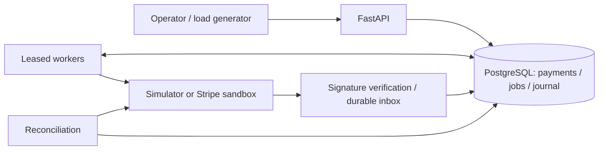

# Architecture and decisions

## Payment write path

1. Validate positive integer minor-unit amount, supported currency, and idempotency key.
2. Insert the payment using the unique idempotency key. A conflict waits for the competing transaction; the subsequent read verifies the original parameters.
3. Insert a deterministic creation job in the **same transaction**.
4. Return `202` after commit. This is durable acceptance, not successful payment.
5. A worker claims one job with a 30-second lease and a fresh token. Claims skip locked rows, allowing independent workers to proceed.
6. Call the provider **outside the database transaction**, using the internal operation ID as provider idempotency key.
7. Lock the local payment, verify provider identity/amount/currency, update its status, and insert its journal posting in one transaction.
8. Acknowledge the job only if the worker still owns its lease token.

A worker can die between any two steps. Steps 2–3 roll back together. Steps 6–7 may leave an ambiguous provider outcome: retry uses the same provider key. Steps 7–8 may cause repeated processing, but the journal's operation primary key prevents a second posting.

## Why PostgreSQL jobs instead of a broker?

A single database transaction makes durable acceptance and job publication atomic without an additional outbox publisher. `SKIP LOCKED` provides competing-consumer claims. This reduces initial failure boundaries and makes the behavior inspectable with SQL. It also means job traffic competes with accounting traffic and grows a hot jobs table. At higher volume, examine query plans, table/index bloat, connection pressure, WAL, and autovacuum before deciding whether a separate broker is justified.

## Accounting representation

A journal row stores `amount`, `currency`, `debit_account`, and `credit_account`. Both sides share exactly the same positive amount. The `ledger_entries` view expands each row into two conventional entries. This schema makes an unbalanced two-leg posting unrepresentable, rather than relying on two separate inserts remaining balanced.

- Successful payment: debit provider clearing; credit merchant payable.
- Successful refund: debit merchant payable; credit provider clearing.

This simplified model excludes provider fees and settlement; it is not a complete merchant accounting product. Reversals require new compensating postings. Triggers prevent normal SQL mutation; a database owner/superuser can bypass database protections. Development Compose uses a privileged local database account. A shared deployment needs separate migration and restricted application roles.

## Refund concurrency

Refund keys are globally unique within this single-owner instance. A transaction advisory lock serializes the same key, even if callers supply different payment IDs. A payment-row lock then serializes reservation checks. `reserved_refunds` includes pending and successful refunds; confirmed failed/canceled refunds release their reservation. Ambiguous or dead jobs retain reservations until the provider outcome is established. Releasing on timeout could permit an actual double refund.

## Events and ordering

Webhook handlers verify signatures over raw request bytes, enforce a size limit, reject live Stripe events, and durably insert inbox+job before acknowledging. An inbox key is provider-qualified and unique. Workers treat events as notifications and retrieve canonical provider state; they do not blindly apply the event's embedded status. Repeated terminal snapshots cannot undo terminal local outcomes. Provider errors fail/retry the event job.

The inbox contains verified event payloads for investigation. A real deployment needs retention and data-minimization rules because provider payloads may contain personal data. Logs intentionally contain IDs and exception classes, not provider responses or keys.

## Reconciliation

Paginated scans retrieve provider payment state and all provider refunds. Known supported state transitions are applied idempotently. External refunds not created by this engine are **reported as unmanaged discrepancies**, not silently booked into its limited accounting model. Unknown provider IDs, amount mismatches, and unsupported states require review. Pending payments whose provider ID was never recorded rely on their creation job's same-key retry; reconciliation reports them as unresolved.

Reconciliation calls providers outside locks. Final local writes revalidate identity under row locks. No distributed transaction spans the provider and local database. The design provides at-least-once processing with idempotent supported effects; it does not claim distributed exactly-once delivery.

## Lease and idempotency boundaries

A provider call or retry can outlive a lease. A second worker may begin while the first still runs. Lease-token checks fence acknowledgments; business-effect idempotency and database constraints protect repeated processing. There is no lease heartbeat yet. A failed job consumes retry budget and eventually becomes `dead`.

Stripe can discard idempotency keys after its retention window. The engine refuses to automatically re-create an unresolved operation older than 23 hours, conservatively requiring review. Existing provider IDs are retrieved rather than recreated. Replaying an old dead job does not bypass that guard.

## Scaling boundaries and limits

API replicas can share PostgreSQL because idempotency is database-backed. Workers can scale independently. Refunds for the same payment deliberately serialize. The simulator uses the same PostgreSQL server, with independent transactions and tables; benchmarks include that database overhead and cannot predict Stripe latency. Shared infrastructure also means simulator state is not an independent disaster-recovery source.

Metrics queries scan completed history for percentiles. They are appropriate for this lab but should become bounded-window aggregates or histogram telemetry at larger volume. The reconciliation endpoint is synchronous and bounded per page; use a scheduled background task for large installations. There is no automatic reconciliation scheduler or alert delivery in this version. The runbook provides operational queries and suggested alert conditions.

## Reference material

- [PostgreSQL row locking and SKIP LOCKED context](https://www.postgresql.org/docs/17/explicit-locking.html)
- [PostgreSQL SELECT locking clauses](https://www.postgresql.org/docs/17/sql-select.html)
- [Stripe idempotency](https://docs.stripe.com/api/idempotent_requests)
- [Stripe webhook delivery considerations](https://docs.stripe.com/webhooks)
